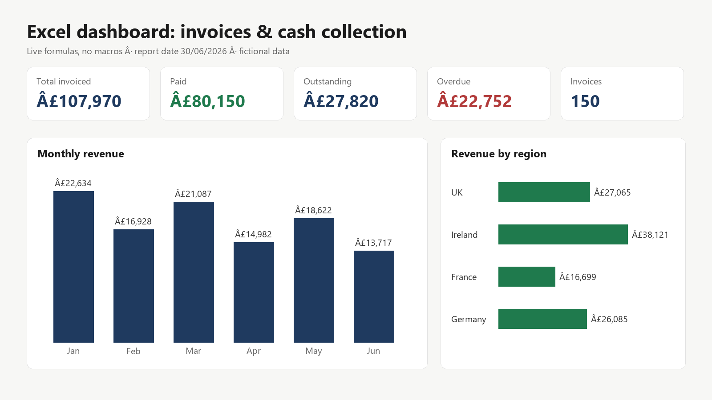

# Excel invoice tracker & live dashboard

An Excel workbook that turns a plain list of invoices into a dashboard you can read in seconds: total invoiced, paid, outstanding, overdue, monthly revenue and revenue by region.



**Download the sample workbook:** [output/invoice-dashboard.xlsx](output/invoice-dashboard.xlsx)

## What the workbook does

- **Invoices sheet**: an Excel table. Paste new invoices at the bottom and it extends automatically.
- **Calculated columns**: amount (qty × unit price) and days overdue for unpaid invoices.
- **Dashboard sheet**: five KPIs and two charts built with standard formulas (`SUMIFS`, `EDATE`, `COUNTA`). Change the report date and every figure updates.
- **Conditional formatting**: overdue invoices are highlighted in red.
- **How it works sheet**: a short guide for the person who will use the file.
- **No macros**: it opens in any recent version of Excel, and it can be imported into Google Sheets.

## Rebuild it

The workbook is generated with Python, so the layout can be adapted to another data set in a few minutes.

```bash
pip install -r requirements.txt
python build_dashboard.py
```

It writes `output/invoice-dashboard.xlsx` and `docs/preview.png`.

Sample data: a fictional company, 150 invoices from January to June 2026, generated with a fixed seed. Expected figures: total £107,970, paid £80,150, outstanding £27,820, overdue £22,752.

## Need something similar?

I build Excel and Google Sheets trackers and dashboards for small businesses: invoices, sales, expenses, stock. Available on Upwork.

## License

MIT
